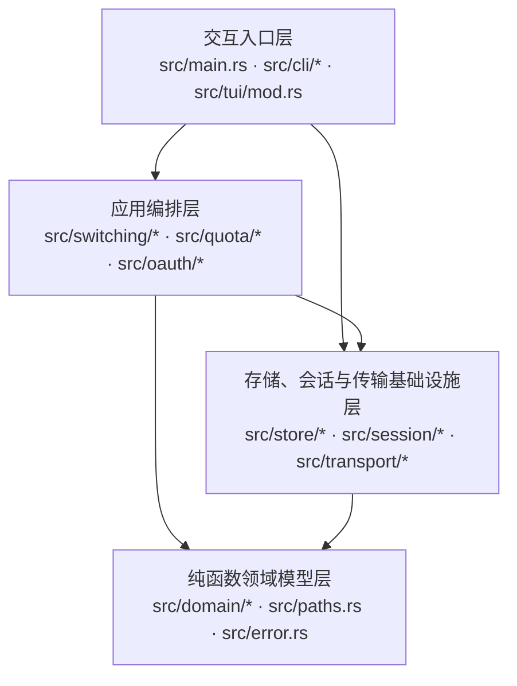
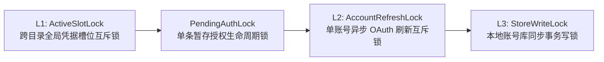

# `agy-switch-cli` 技术架构、安全机制与验收台账

> 返回首页：[README.md](../README.md) ｜ 完整使用与部署手册：[user-guide.md](user-guide.md) ｜ 重构溯源声明：[PROVENANCE.md](../PROVENANCE.md)

本文档面向希望深入了解 `agy-switch-cli` 内部工作原理、并发安全机制、崩溃恢复协议及质量验证边界的用户与维护者，系统说明本项目的工程架构与实测验收数据。

---

## 目录

1. [设计目标与核心架构边界（做什么 / 不做什么）](#1-设计目标与核心架构边界做什么--不做什么)
2. [代码模块分层全景与职责导览](#2-代码模块分层全景与职责导览)
3. [三域存储拓扑、磁盘状态文件与安全 I/O 防护](#3-三域存储拓扑磁盘状态文件与安全-io-防护)
4. [并发控制、崩溃对账与防令牌回退协议](#4-并发控制崩溃对账与防令牌回退协议)
5. [CloudCode 配额观测链路、四态评估与自动切号引擎](#5-cloudcode-配额观测链路四态评估与自动切号引擎)
6. [秘密零回显防护与终端信号安全](#6-秘密零回显防护与终端信号安全)
7. [跨平台构建矩阵、性能基准与诚实验收边界台账](#7-跨平台构建矩阵性能基准与诚实验收边界台账)

---

## 1. 设计目标与核心架构边界（做什么 / 不做什么）

`agy-switch-cli` 源自混合桌面项目 `agy-switch` 的领域规则提炼，但在工程架构上针对 **Linux 无头环境（远程 SSH 服务器、Docker 容器、WSL2 与自动化流水线）** 进行了从零重构。

### 1.1 核心架构取舍

| 维度 | 传统桌面端方案 | `agy-switch-cli` 无头架构设计 |
| :--- | :--- | :--- |
| **运行形态与系统依赖** | 依赖 Tauri / GTK / WebKitGTK / X11 / Wayland 及系统动态库 | **零 GUI 动态库依赖**，预编译 `musl` 二进制为 100% 纯静态单文件 ELF（`NEEDED = 0`） |
| **目标客户端范围** | 同时尝试操作桌面 App、VS Code / IDE 的 `state.vscdb` SQLite 数据库与网页注入 | **专注服务官方无头 `agy` CLI**，不触碰 IDE SQLite 数据库，不注入脚本，也不伪造桌面设备指纹 |
| **切号生效方式** | 通过强杀并重启桌面客户端进程来切换会话 | **非侵入式原子替换凭据槽位**：仅对切换完成后新启动的 `agy` 进程生效，绝不强行中断正在运行中的 `agy` 任务 |
| **桌面钥匙串兼容** | 绑定系统 `libsecret` 动态库 | 默认 `auto` 自适应后端：无头环境走纯文件后端（`file`），`-all-features` 版在检测到活跃桌面钥匙串服务时自动启用纯 Rust `zbus` 协议栈实现 `org.freedesktop.secrets` 事务性双写与失败回滚（亦可配 `run --isolate-dbus` 按子进程隔离钥匙串） |

### 1.2 切号生效语义与进程边界

1. **凭据生效机制**：官方 `agy` 在启动阶段读取 `~/.gemini/antigravity-cli/antigravity-oauth-token`（在存在活跃桌面 D-Bus Secret Service 的图形会话中则会优先查询系统钥匙串）。`switch` 提交成功代表新账号凭据已以 `0600` 权限完成原子写入并通过回读校验。
2. **运行中会话保护**：已经启动并正在运行的 `agy` 进程在内存中持有其启动时加载的身份会话。本工具不会向运行中的 `agy` 进程注入信号或篡改其内存状态；在默认安全策略下，当检测到未受管的运行中 `agy` 进程时，`switch` 与 `run` 会主动返回退出码 `8`（`EnvironmentNotReady`）提醒用户，避免造成“磁盘槽位已换、用户误以为旧窗口也已切换”的认知偏差。

---

## 2. 代码模块分层全景与职责导览

全工程为单一纯 Rust 包（无前端工程与 C/GUI 胶水层），内部遵循严格的单向依赖分层：



### 2.1 `src/` 目录模块速查表

| 模块路径 | 核心职责说明 |
| :--- | :--- |
| `main.rs` / `lib.rs` / `paths.rs` | 原始 `args_os` 非 UTF-8 安全入口、目录解析（支持 `--data-dir` 与 XDG 规范）与顶层信号退出码映射 |
| `error.rs` | 统一错误类型 `CliError`、稳定退出码枚举 `ExitCode`（`0..=8`）以及基于语法结构的 `clap` 参数与 JSON 解析错误脱敏器 |
| `domain/account.rs` | 账号记录 `AccountRecord`、暂存授权记录 `PendingAuthRecord`、单调世代判定纯函数与跨机备份包 `TransferBundle` 结构 |
| `domain/token.rs` | OAuth 令牌模型 `TokenRecord`（自定义 `Debug` 隐藏所有令牌字段）与 SHA-256 刷新令牌摘要计算 |
| `domain/quota.rs` | 配额池分类（`Gemini` / `ThirdParty` / `Argon`）、四态配额评估纯函数 `evaluate_account_quota`（默认 `3600s` 保鲜期） |
| `domain/policy.rs` / `config.rs` / `clock.rs` | 自动切号策略模型与逐字段校验器、`config.json` 配置解析（`Debug` 自动脱敏密钥与代理口令）、单调锚定测试时钟 |
| `store/locks.rs` | 基于 POSIX `flock` + 线程级顺序守卫的四级单向锁实现（`L1`、`PendingAuthLock`、`L2`、`L3`）与 `DaemonInstanceLock` |
| `store/fs_atomic.rs` | 全深度祖先符号链接拦截、`O_NOFOLLOW \| O_NONBLOCK` 有界普通文件读取、临时文件与父目录双 `fsync` 原子写入及故障注入钩子 |
| `store/repository.rs` / `transfer.rs` | 账号库事务读写、单调授权序号 `auth_sequence.json`、两级轮换指纹谱系归档、备份包导入导出与旧桌面端只读迁移 |
| `session/backend.rs` / `payload.rs` | 官方凭据 JSON 序列化校验、`auto` 自适应探测、`file` 纯文件后端、纯 Rust `zbus` 系统钥匙串事务性双写/自动回滚后端，以及 `--from-local` 本机已登录凭据提取器 |
| `session/journal.rs` / `process.rs` | 三阶段崩溃恢复日志 `switch_journal.json` CAS 对账机、`/proc` 故障关闭进程扫描与双因子（`pid + starttime`）进程租约 |
| `transport/client.rs` / `proxy.rs` / `user_agent.rs` | 基于 `reqwest` + `rustls` 的 HTTP 传输抽象、系统代理环境变量自动规范化与异常项容错隔离（支持 `socks5h`/`socks`、裸 `host:port` 与精确 `url::Host` 本地回环直连分流）、`antigravity/hub/<ver>` 请求标识管理 |
| `oauth/registry.rs` / `flow.rs` / `refresh.rs` | 内置与自定义 OAuth 客户端注册表、PKCE（`S256`）授权流、全入口 `/token` 签发后立即 `0600` 落盘与并发防回退续期闭环 |
| `quota/client.rs` / `fusion.rs` | 单环境隔离的 CloudCode 三步配额拉取（`Daily -> Sandbox -> Production`）、401 单次强刷重试与双窗口配额融合 |
| `switching/executor.rs` / `runner.rs` / `daemon.rs` | 切号核心执行器、`run -- agy` 受管包装启动器与七阶段前台自动切号守护引擎 |
| `cli/*` / `tui/mod.rs` | 命令行参数定义（严格 `<ID\|EMAIL>` 不可变账号选择器）、无回显私密令牌读取器、物理白名单 DTO 渲染器（含双窗口配额进度表）与自适应窗口尺寸/滚动视口的 SSH 交互式终端看板 |

---

## 3. 三域存储拓扑、磁盘状态文件与安全 I/O 防护

### 3.1 三域物理隔离设计

为保持官方 `agy` 目录干净，并允许同一台机器上的不同 `--data-dir` 实例安全协调对同一个官方凭据文件的访问，磁盘路径划分为三个职责分明的域：

| 存储域 | 默认路径 | 权限要求 | 存放内容与设计目的 |
| :--- | :--- | :---: | :--- |
| **1. 独立账号仓库域 (`data_dir`)** | `$XDG_DATA_HOME/agy-switch-cli`<br>（回退 `~/.local/share/agy-switch-cli`） | 目录 `0700`<br>文件 `0600` | 存放账号库、策略、配置及所有内部事务状态与中下层文件锁 |
| **2. 全局锁与缓存域 (`cache_dir`)** | `$XDG_CACHE_HOME/agy-switch-cli`<br>（回退 `~/.cache/agy-switch-cli`） | 目录 `0700`<br>文件 `0600` | 存放跨 `--data-dir` 共享互斥的顶层槽位锁 `locks/slot-<sha256>.lock`、钥匙串锁 `locks/keyring-<uid>.lock` 及 24 小时客户端版本缓存 `ua_version.json` |
| **3. 官方凭据生效位 (`active_slot`)** | `~/.gemini/antigravity-cli/antigravity-oauth-token` | 文件 `0600` | 官方 `agy` 实际消费的凭据文件。本工具绝不在该目录内创建 `.lock` 文件，确保官方客户端目录始终洁净 |

`data_dir` 内部文件布局如下：

```text
~/.local/share/agy-switch-cli/          (0700)
├── index.json                          (0600) 账号排列顺序、当前选中账号 ID 与单调版本号 revision
├── policy.json                         (0600) 自动切号开关、阈值、策略、候选账号列表与 revision
├── config.json                         (0600, 可选) 固定网络代理与自定义 OAuth 客户端配置
├── accounts/                           (0700)
│   └── <account_id>.json               (0600) 单账号令牌、配额缓存、授权世代与近 512 条已淘汰令牌摘要
└── state/                              (0700)
    ├── switch_journal.json             (0600, 仅切号瞬态存在) 切号事务崩溃恢复日志
    ├── daemon_state.json               (0600) 守护进程冷却截止时间、轮询游标与连续失败暂停标志
    ├── auth_sequence.json              (0600) 全局单调递增的授权签发序号（摆脱系统时钟回拨影响）
    ├── pending_auth/<id>.json          (0600) 已从 Google 换出令牌但尚未完成 userinfo 入库的暂存保险箱
    ├── pending_lineage/<id>.json       (0600) 暂存记录在续期过程中产生的中间轮换摘要链
    ├── token_lineage/<id>.json         (0600) 超出 512 条上限后的历史淘汰令牌摘要溢出归档（上限 65,536 条）
    ├── leases/<pid>.json               (0600) 受管 `run -- agy` 子进程的双因子（pid + starttime）活跃租约
    └── locks/                          (0700) PendingAuthLock、L2 单账号刷新锁、L3 仓库写锁与 Daemon 单实例锁
```

### 3.2 防御性文件 I/O 机制（`store/fs_atomic.rs`）

所有受管配置文件、账号文件与导入读取路径均经过以下四层底层防护：
1. **全深度祖先符号链接拦截**：从受管根目录（或导入/导出目标路径的各级父目录）自顶向下逐级执行 `lstat`（`symlink_metadata`），任何一层出现符号链接均立即拒绝操作，防止越权读写预期目录之外的文件。
2. **父目录句柄与 `(dev, ino)` 双重锚定**：打开目标文件时结合 `O_PATH | O_DIRECTORY | O_NOFOLLOW` 校验父目录身份，并在打开前后核对设备号与 inode 一致性，消除路径检查与实际打开之间的竞态窗口（TOCTOU）。
3. **非阻塞有界普通文件读取**：使用 `O_NOFOLLOW | O_NONBLOCK | O_CLOEXEC` 打开文件并验证 `file_type().is_file()`，若攻击者或异常环境在状态文件路径放置了无写端命名管道（FIFO）或设备节点，可在毫秒级立即识别并报错退出，不会导致进程永久挂起；同时严格限制单文件最大读取字节数防止内存耗尽。
4. **双 `fsync` 原子替换写入**：所有状态更新均先在同一父目录下创建带随机后缀的 `0600` 临时文件，写满后先对临时文件执行 `sync_all()`（`fsync`），再执行 POSIX 原子 `rename` 覆盖目标文件，最后对父目录句柄再次执行 `fsync`，确保断电或内核崩溃后不会出现半写损坏的 JSON 文件。

### 3.3 官方客户端双层凭据存储与事务性双写机制（`session/backend.rs`）

官方 `agy` CLI（及新版独立桌面端 Antigravity App）内部共用同一套双层凭据存储（`composite_token_storage.go`）与同一组 OAuth `client_id`，按以下固定优先级定位当前登录凭据：

1. **第一优先级：Linux 桌面系统钥匙串（D-Bus Secret Service）**
   - 当会话中存在可达的 D-Bus 总线且运行着 GNOME Keyring 或 KDE Wallet（`org.freedesktop.secrets`）时，官方 `agy` 与桌面端 Antigravity App 均优先读写钥匙串 `login` / `default` 集合中属性为 `service="gemini", username="antigravity"`（显示名 `Password for 'antigravity' on 'gemini'`）的加密条目。
   - 只要钥匙串已解锁且存在该条目，官方客户端在启动阶段直接采用钥匙串中的凭据，不再读取磁盘文件；即便手动清理磁盘上的旧凭据文件，官方客户端与本工具的钥匙串后端均能正常按第一优先级读取当前身份。
2. **第二优先级：磁盘凭据文件回退层**
   - 当环境不存在桌面钥匙串（如纯无头 SSH 服务器、Docker 容器、无桌面 WSL2）、钥匙串中无对应条目，或通过 `run --isolate-dbus` 将子进程 `DBUS_SESSION_BUS_ADDRESS` 定向至 `/dev/null` 时，`agy` CLI 回退读写 `~/.gemini/antigravity-cli/antigravity-oauth-token`（桌面端 Antigravity App 与 VS Code 中的 Antigravity 扩展插件则回退读写 `~/.gemini/jetski-standalone-oauth-token`；而常见的 `~/.gemini/oauth_creds.json` 并非官方 Antigravity App 或 `agy` CLI 读写的槽位）。
3. **`auto` 自适应后端与事务性双写（Dual-Write）协议**
   - 为保持无头服务器标准版的最小体积（约 `8.2 MiB`）与精简依赖面，纯 Rust D-Bus 协议栈（`zbus`）与 DH/AES 通道加密库被隔离在 `secret-service-backend` 编译特性（即 `-all-features` 发行版，约 `10.3 MiB`，同样零外部 `.so` 依赖）中。
   - 在默认 `--backend auto` 模式下，标准版直接使用 `FileSessionBackend`；`-all-features` 版先通过零副作用 `stat` 检查本机是否存在活跃 D-Bus 会话套接字，再以只读不解锁（零弹窗）方式探测 `org.freedesktop.secrets` 是否持有持久化集合——若存在桌面钥匙串则自动启用 `SecretServiceSessionBackend`（无论命令行 `switch`、`current`、`daemon`、`accounts add --from-local` 还是 `tui` 看板均自动生效），若处于无钥匙串的服务器环境则自动无感回退至 `FileSessionBackend`。
   - 执行切号写入时，`SecretServiceSessionBackend` 在持有全局 `L1` 槽位锁与 UID 级钥匙串锁的前提下执行事务性双写：先快照备份所有目标钥匙串集合与磁盘槽位文件，随后写入钥匙串并通过即时回读校验字节一致性，最后原子写入磁盘 `antigravity-oauth-token`；若任意集合写入或磁盘落盘失败，自动将已修改的钥匙串集合逆序回滚至切换前快照（若回滚自身亦遭遇故障则持久化 `RecoveryIncomplete` 状态并以退出码 `7` 阻断后续写入，交由 `doctor --fix` 对账恢复）。

---

## 4. 并发控制、崩溃对账与防令牌回退协议

### 4.1 四级单向锁顺序（编译期与运行期双重防死锁）

当后台守护进程 `daemon`、受管启动器 `run`、交互式看板 `tui` 与命令行手动 `refresh`/`switch` 同时运行时，系统通过严格的单向锁获取顺序避免死锁：



- **单向获取不变量**：任何线程一旦持有低层级锁（例如已持有 `L2` 或 `L3`），若试图反向获取高层级锁（如 `L1` 或阻塞等待另一把 `PendingAuthLock`），线程局部锁栈守卫会立即在运行期拦截报错。
- **L3 纯同步闭包约束**：`with_store_write_lock` 在 Rust 类型签名上仅接受同步闭包 `FnOnce(&StoreWriteTx<'_>)`，不接受 `async` Future，从编译器层面保证了持有仓库写锁期间绝不会跨越任何网络 `.await` 等待。
- **锁文件持久化不删除**：所有 `.lock` 文件在释放 `flock` 时仅关闭文件描述符而不执行 `unlink`，避免并发进程锁在不同 inode 上导致互斥失效。

### 4.2 三阶段切号事务日志与崩溃恢复（`session/journal.rs`）

切换账号需要同时更新“外部官方凭据槽位（及可选系统钥匙串）”和“内部 `index.json` 选中记录”，这两处位于不同目录，无法用单次文件系统 `rename` 原子完成。为此系统引入了预写日志 `switch_journal.json`：

1. **阶段一（`Prepared`）**：在持有 `L1` 锁的前提下，读取当前官方槽位内容并计算其 SHA-256 指纹 `prev_slot_digest` 与新凭据指纹 `target_slot_digest`，先将 `Prepared` 阶段日志持久化落盘。
2. **阶段二（更新外部槽位并推进至 `CommittedIndexPending`）**：将新账号凭据写入官方生效位（若启用 `secret-service` 则先写钥匙串再写文件，写文件失败时自动将钥匙串回滚至旧快照），回读校验字节摘要完全匹配后，将日志推进为 `CommittedIndexPending`。
3. **阶段三（提交内部索引并清理日志）**：获取 `L3` 写锁更新 `index.json` 的 `selected_account_id`，最后删除 `switch_journal.json`。

**崩溃恢复与外部漂移保护（CAS）**：
- 若进程在阶段一刚写完、尚未改动槽位时遭遇 `SIGKILL` 或断电，下次操作对账时发现槽位指纹仍等于 `prev_slot_digest`，直接清理未提交日志即可无损恢复。
- 若进程在阶段二写完槽位后、`index.json` 更新前崩溃，下次对账发现槽位指纹等于 `target_slot_digest`，会自动前滚补齐 `index.json` 并清理日志。
- 若崩溃后用户在外部直接运行了官方 `agy login` 登录了第三个新账号，此时槽位实际指纹既不等于 `prev_slot_digest` 也不等于 `target_slot_digest`，对账机不会盲目用旧快照覆盖用户刚在外部登录的新凭据，而是安全保护现场。

### 4.3 零丢码暂存、授权世代（`auth_seq`）与两级防回退谱系

Google OAuth 刷新令牌在轮换或重新授权时，一旦服务端 `/token` 接口返回了新令牌，旧令牌可能立即作废。如果在拿到新令牌之后、查询用户邮箱（`userinfo`）时发生网络中断或用户按了 `Ctrl+C`，常规实现就会把刚拿到的新令牌丢在内存里导致账号报废。本工具采用三项机制彻底解决该问题：

1. **全入口即时 `0600` 落盘**：无论是 `auth login`、`auth reauthorize`、`accounts add` 还是后台续期，只要 `/token` HTTP 响应成功返回，第一件事就是将新令牌以 `0600` 权限写入 `state/pending_auth/<id>.json`（或原地合并进账号记录），随后才去请求 `userinfo` 接口。即使网络当场断开，用户稍后运行 `auth pending --resume` 即可无损完成绑定。
2. **单调授权世代（`auth_seq` 与 `auth_generation`）**：每次新授权暂存时，从 `state/auth_sequence.json` 分配全局单调递增的序号 `auth_seq`；绑定入库时推进账号的 `auth_generation`（与日常自动续期的 `token_version` 严格区分）。当一个因锁竞争滞后的旧 `pending` 记录苏醒时，在发起网络请求前和写库前都会检查世代号，一旦发现目标账号已经完成了更新一轮的授权，立即零网络开销安全退出，不会把账号回退到旧令牌。若 `reauthorize` 过程中用户误登了另一个邮箱，系统会立即为该暂存记录打上 `email_mismatch = true` 隔离标记，既不污染原账号谱系，也不误删异号有效令牌。
3. **两级轮换指纹谱系（`66,048` 次历史追溯）**：账号文件内联保留最近 `512` 条已淘汰刷新令牌的 SHA-256 摘要，超出部分自动归档至 `state/token_lineage/<id>.json`（容量 `65,536` 条）。当用户拿一份几个月前导出的旧备份包执行 `accounts import --overwrite` 时，系统能准确识别出备份里的旧令牌属于已被轮换淘汰的历史祖先并予以拦截（退出码 `5`）。

---

## 5. CloudCode 配额观测链路、四态评估与自动切号引擎

### 5.1 单环境隔离的三步配额观测协议（`quota/client.rs`）

1. **环境优先级与单环境隔离**：默认按官方客户端实际消费额度的 **`Daily`（`daily-cloudcode-pa.googleapis.com`） -> `Sandbox` -> `Production`（`cloudcode-pa.googleapis.com`）** 顺序探测。每个候选环境独立查询其自身的 `:loadCodeAssist`（获取项目 ID 与订阅层级）、`:fetchAvailableModels`（获取模型目录与单模型主配额）和 `:retrieveUserQuotaSummary`（获取 `Weekly` 与 `5h` 配额池摘要），绝不把不同环境的层级或摘要桶混合拼接成虚假数据。
2. **协议头与残缺摘要兜底**：发送与官方 Hub 一致的 `antigravity/hub/<version> (os_type=linux; arch=amd64|arm64)` 请求标识，确保服务端完整下发 Gemini 共享池与可能存在的 `Argon` 独立周池。若某环境 HTTP 200 响应仅包含第三方 `Claude/GPT` 组而缺失 `Gemini` 池，系统会将其暂存为完整单环境保底结果并继续向后探测（即使中间环境遇到目录/摘要 HTTP `404`、通用 `403`、`429`/`5xx` 或目录 JSON 解析异常也会继续探测后续环境）；仅当后续环境返回包含 `Gemini` 池的完整摘要时才整体采用后者，否则安全回退返回首环境的保底观测。
3. **401 强刷闭环与阻断分类**：配额请求若在任意环境遇到 HTTP 401 或 `ACCESS_TOKEN_SCOPE_INSUFFICIENT`（权限范围不足），均作为账号级鉴权错误立即处理（其中 HTTP 401 会在 `L2 -> L3` 锁保护下执行至多 **1 次**强制 OAuth 令牌续期并重放请求，轮换新令牌立即持久化，绝不以旧 partial 观测吞没鉴权错误）；若遇 `VALIDATION_REQUIRED`（需网页安全验证），则立即停止向后探测——当前尚无有效单环境观测时精确记录验证阻断证据，若前序环境已成功取得 HTTP 200 单环境保底观测则优先保留该有效观测。

### 5.2 四态配额评估模型（`domain/quota.rs`）

评估函数 `evaluate_account_quota` 纯函数化输出四种确定性状态：
- **`Known { remaining_percentage }`**：缓存在保鲜期内（默认 `<= 3600` 秒）、所有相关配额桶的 `reset_time > 当前时间`，且数据完整有效。有效剩余百分比取 `min(周额度, 5h 额度, 模型主观测额度)` 的木桶短板值（其中同环境确认的 `Free` 层级允许无 `5h` 桶；`Argon` 为独立周池；带 `-disabled` 后缀的模型保持未知态不借用共享池）。
- **`Stale { reason }`**：缓存距今已超过 `3600` 秒（`stale_quota`），或任一配额桶已跨过重置时间点（`reset_deadline_passed`，在重新联网确认前绝不盲目假定远端已恢复为 100%）。
- **`Unknown { reason }`**：尚未拉取过配额、缺失核心窗口桶，或存在冲突桶数据。
- **`Unavailable { reason }`**：账号已被禁用、处于网页安全验证阻断期，或配额接口返回全环境 HTTP 403 Forbidden。

### 5.3 受管启动 `run` 与七阶段守护引擎 `daemon`

- **双因子防 PID 复用租约（`session/process.rs`）**：`run -- agy` 启动子进程后，读取 `/proc/<pid>/stat`（反向定位最后一个 `)` 以抵御包含空格或括号的特殊进程名）提取第 22 字段内核启动时钟滴答 `starttime`，将 `(pid, proc_starttime_ticks, account_id)` 写入 `state/leases/<pid>.json`。即使子进程异常崩溃且 Linux 内核稍后将该 PID 分配给了其他无关进程，由于 `starttime` 不匹配，旧租约会被立即识别为已失效而不会阻塞守护进程；若容器完全屏蔽了 `/proc` 导致进程状态无法核实，系统按**故障关闭（Fail-Closed）**拒绝盲目切号。
- **七阶段守护状态机（`switching/daemon.rs`）**：每轮巡检（默认间隔 `3600s ± 10%`，切号冷却 `3600s`）依次经历：
  1. `Observe`（对账日志、检查冷却与暂停状态、评估当前账号本地缓存）；
  2. `Evaluate`（若当前账号额度已知且高于 `reserve_percentage`，零网络请求直接休眠；若缓存过期则仅刷新当前账号复核）；
  3. `Prepare`（当前账号确已跌破 `reserve_percentage` 时，记录此刻的 `index.revision` 与 `policy.revision` 快照，按默认的 `round-robin` 或 `priority` 顺序受控刷新探测未禁用候选账号直至找到首个 `>= candidate_min_percentage` 的达标目标）；
  4. `Guard`（先核验 `/proc` 与版本快照：若在 `Prepare` 期间或跨轮等待期间 `index.revision`、`policy.revision` 或槽位指纹已发生变更则立即作废旧计划；随后在默认的 `immediate` 模式下不中断运行中的 `agy` 进程而直接进入重验与切槽供后续新终端使用，在 `wait` 模式下若检测到活跃 `agy` 进程则暂缓等待空闲；无论何种模式，若遇到 `/proc` 不可读即 `RuntimeState::Unverified`，均严格保持故障关闭绝不盲写）；
  5. `Revalidate`（在真正获取 `L1` 切号前，重新核对 `index.revision`、`policy.revision`、槽位指纹以及高优先级候选状态——若在网络探测期间用户手动切了号、改了策略或排在前面的候选号已被重新启用，立即取消过时切换计划）；
  6. `Commit`（在 `L1` 锁下原子提交切号并写入冷却截止时间；连续 3 次提交失败自动置 `paused_on_failure = true` 保护停机）；
  7. `Sleep`（可被 `SIGTERM` / `SIGINT` 毫秒级唤醒并优雅退出）。

---

## 6. 秘密零回显防护与终端信号安全

1. **命令行与错误通道零回显**：
   - `accounts add` 物理上不设明文 Token 位置参数；程序入口使用 `std::env::args_os()`，遇到非法非 UTF-8 字节参数时直接返回脱敏用法错误（退出码 `2`）而不会触发 panic 或回显原始字节。
   - 自定义 `clap` 错误格式化器仅输出白名单内的命令词与选项名，任何未知位置参数或 `--flag=secret` 内联值一律替换为 `[REDACTED]`；所有含环境变量绑定的参数均启用 `hide_env_values = true`，防止 `--help` 把当前环境变量中的值打印到终端。
   - JSON 反序列化错误仅提取行号、列号与分类描述，剔除 `serde_json` 错误文本中可能夹带的原始字段片段。
2. **DTO 物理白名单输出**：
   - 所有对外展示与 `--json` 序列化均通过独立的只读视图结构体（`AccountViewDto`、`QuotaViewDto`、`SelectedAccountBriefDto`）转换，结构体定义中物理上不存在 `access_token`、`refresh_token`、`id_token`、`client_secret` 等敏感字段；动态文本在渲染到人类终端前统一经过控制字符过滤，防止恶意备注或远端字符串注入 ANSI 终端转义序列。
3. **终端 `ECHO` 与备用屏幕信号级恢复**：
   - 无回显密码输入（`secret_input.rs`）与交互式看板（`tui/mod.rs`）同时部署了 Rust RAII `Drop` 守卫与异步信号安全的 POSIX `sigaction` 处理器（覆盖 `SIGINT`、`SIGTERM`、`SIGHUP`、`SIGQUIT`）。即使进程在等待输入或全屏看板期间收到外部终止信号，也会先恢复原始 `termios` 回显属性并退出备用屏幕，不会把用户的 SSH 终端留在盲打乱码状态。

---

## 7. 跨平台构建矩阵、性能基准与诚实验收边界台账

### 7.1 四目标 × 三特性档 Release 产物实测矩阵

**基准测量环境**：Linux `x86_64`（EndeavourOS，内核 `7.3.4-zen2-1-zen`，`rustc 1.100.0` 主工具链 + 精确最低支持版本 `rustc 1.89.0` MSRV 工具链，`cargo-deny 0.20.2`，`cargo-audit 0.23.0`，`zig 0.17.1` + `cargo-zigbuild`，`qemu-aarch64-static`；Release 编译配置为 `lto = "thin"`、`codegen-units = 1`、`strip = "symbols"`）。

| 目标三元组 (`--target`) | 精简无头 (`--no-default-features`) | 默认含 `tui` | 全特性 (`--all-features`) | ELF 链接属性与 `readelf` 核验结果 |
| :--- | :---: | :---: | :---: | :--- |
| **`x86_64-unknown-linux-gnu`** | `~7.7 MiB` | `~7.9 MiB` | `~10.1 MiB` | 动态链接 glibc：仅依赖 `libc.so.6`、`libm.so.6`、`libgcc_s.so.1`、`ld-linux-x86-64.so.2`（**0 桌面/GUI 库**） |
| **`x86_64-unknown-linux-musl`** | `~7.8 MiB` | `~8.2 MiB` | `~10.3 MiB` | **`static-pie` 完全静态 ELF**：无 `PT_INTERP`、**`0` 个 `NEEDED` 共享库**；本机原生三特性档全量测试通过 |
| **`aarch64-unknown-linux-musl`** | `~6.4 MiB` | `~6.6 MiB` | `~8.5 MiB` | **`statically linked` 完全静态 ARM64 ELF**：无 `PT_INTERP`、**`0` 个 `NEEDED` 共享库**；通过 QEMU 用户态端到端冒烟 |
| **`aarch64-unknown-linux-gnu`** | `~6.6 MiB` | `~6.9 MiB` | `~8.8 MiB` | 动态链接 ARM64 glibc：仅依赖基础 C/数学运行库（**0 桌面/GUI 库**）；通过 QEMU 用户态端到端冒烟 |

### 7.2 本机原生运行性能指标（`x86_64`）

| 指标项 | 工程设计目标 | 本机实测范围（`gnu` / `musl`） | 测量方法说明 |
| :--- | :---: | :---: | :--- |
| **只读命令进程启动耗时（页缓存热态）** | `P95 < 15 ms` | **`P50 ~5.5–5.6 ms` / `P95 ~6.0–6.3 ms`** | 3 次预热后连续拉起 50 个新子进程端到端计时（含 `/proc` 实时扫描） |
| **前台 `daemon` 空闲常驻内存 (`VmRSS`)** | `< 15 MB` | **`gnu`: `~9.9 MiB` / `musl`: `~8.7 MiB`** | 全特性档空闲监控态读取 `/proc/<pid>/status` 中 `VmRSS` |
| **GUI / 桌面 / `libdbus` 动态库依赖数** | `0` | **全部 12 份 Release 产物均为 `0`** | `readelf -l` + `readelf -d` 逐份静态扫描核验 |

### 7.3 验收证据范围与待外部闭环事项（诚实状态台账）

下表区分**已在自动化测试与云端 CI 中实测验证的范围**与**受运行环境限制仍需持续关注的边界事项**：

| 验证领域 | 已完成的验证范围 | 边界说明与后续关注项 |
| :--- | :--- | :--- |
| **构建、MSRV 与云端 CI 门禁** | 本机隔离沙盒与 GitHub Actions 云端（`Ubuntu 26.04` 5 项门禁作业）均已实测通过：`cargo fmt --check`、`rustc 1.100.0` 与最低 MSRV `rustc 1.89.0` 三特性档零警告 `clippy`、三特性档全量单元与集成测试（含 `--test-threads=64` 高并发交错压测）、`x86_64` 与 `aarch64` 纯静态 `musl` 构建及 QEMU 端到端正负向冒烟（见 [`.github/workflows/ci.yml`](../.github/workflows/ci.yml)）。 | 云端与本机针对 `aarch64` 的自动化运行验证基于 QEMU 用户态仿真完成，不等同于原生物理 ARM64 服务器硬件上的高负载压测。 |
| **官方 `agy` 契约与在线协议** | 已基于隔离临时 `HOME`、本地 HTTP/SOCKS5 Mock 服务及私有 Mock D-Bus Secret Service 完整验证凭据读写、双写回滚、PKCE 换码、401 强刷闭环、`Daily` 优先单环境配额融合与 3p-only 残缺摘要保底逻辑，并经维护者实机验证真实配额刷新与切号流程。 | Google CloudCode 内部接口（如 `:retrieveUserQuotaSummary` 的配额池命名与请求头策略）并非公开固定规范，若未来上游服务端调整返回结构，需随版本迭代同步适配。 |
| **并发锁、崩溃恢复与防回退** | 已通过四轮独立第三方零信任代码审计，自动化测试覆盖跨目录混合后端 `L1` 锁互斥、四级锁序防死锁、`PendingAuthLock` 与 `auth_seq` 跨 pending 忙锁防回退、`email_mismatch` 异号保护、全深度符号链接与 FIFO 非阻塞拦截、真实子进程 `SIGKILL` 崩溃日志恢复，以及 `66,048` 级轮换谱系防旧备份覆盖（注：当既有 `index.json` 文件内容损坏而非缺失时，`doctor --fix` 会安全拒绝盲目覆盖并保留现场供人工核查）。 | 进程级故障注入与 `SIGKILL` 测试验证了应用层协议的一致性，不等同于物理断电或底层存储介质硬件损坏场景下的全矩阵测试。 |
| **许可证与第三方依赖审计** | 完整保留 `CC-BY-NC-SA-4.0` [`LICENSE`](../LICENSE) 与 [`PROVENANCE.md`](../PROVENANCE.md)，通过 `cargo deny check advisories bans licenses sources` 四项全检及 `cargo audit`（0 安全漏洞）。 | 可选特性 `secret-service 5.2.0` 经 `zbus 5.19.0` 传递依赖 3 个已合并至 `zbus 6.0` 的子包（`RUSTSEC-2026-0370`/`0371`/`0372` 仓库合并维护提示，无安全漏洞），以及 `chrono 0.4.45` 维护状态提示（`RUSTSEC-2026-0543`，非安全漏洞，计划在 `v1.2.0` 迁移至 `jiff`/`time`），均已在 [`deny.toml`](../deny.toml) 中记录说明。 |
